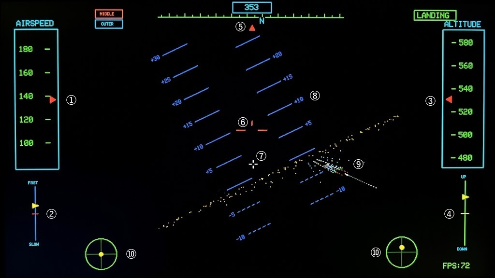

# TAB5 Cockpit - Night Landing Flight Simulator

ESP32-P4（M5Stack TAB5）向けに開発された夜間着陸シミュレーターです。  
滑走路照明（進入灯フラッシャー、接地帯灯、末端灯など）や計器盤（HUD、速度計・高度計・昇降計テープ）をリアルタイム描画し、夜間の計器進入・着陸をシミュレートします。

---

## 1. 機種選択 (AIRCRAFT MODEL)

タイトル画面で以下の3機種から選択できます。

- **1: ARCADE**  
  * 直感的な挙動の簡易フライトモデルです。フライトシミュレーターが初めての方はこちらで慣れるとよいでしょう。  
  * 失速やエンジンの応答遅れがなく、入力したスティックの角度へダイレクトに機首が向きます。  
  * 垂直方向の降下は機首の向きだけで決定されます。

- **2: HONDA-JET**  
  * 小型ビジネスジェット特有の軽快な運動性を再現した3D空力モデルです。  
  * 揚力・抗力・横滑り・失速をリアルタイムに計算し、舵の効きが非常にシャープです。  
  * 過度な機首上げや速度低下によって迎え角が限界（約18度）を超えると失速し、ノーズドロップが発生します。

- **3: B-737**  
  * 大型旅客機の重量感と操舵応答遅れ、およびジェットエンジンのスプール遅れ（吹け上がり2.5秒 / 減速2.0秒）を忠実に再現しています。  
  * 舵を当ててから機体が実際にロール・ピッチを開始するまでに慣性遅れが発生します。  
  * 操作に対して一呼吸遅れて挙動が現れるため、先の動きを予測した丁寧な操縦が要求される上級者向けモデルです。

---

## 2. 操縦方式 (CONTROL MODE)

画面の左右エリアをドラッグして操縦する仮想デュアルスティック方式です。RC飛行機/ドローン送信機の操作体系に合わせた2種類のモードを選択できます。

- **MODE 1**  
  * 左スティック（L）: 上下＝ピッチ（昇降舵） / 左右＝ヨー（方向舵）  
  * 右スティック（R）: 上下＝スロットル（推力） / 左右＝ロール（補助翼）

- **MODE 2**  
  * 左スティック（L）: 上下＝スロットル（推力） / 左右＝ヨー（方向舵）  
  * 右スティック（R）: 上下＝ピッチ（昇降舵） / 左右＝ロール（補助翼）

- **操作のポイント**  
  * ピッチ・ロール・ヨーは指を離すと自動的に中央（ニュートラル）へ戻ります。  
  * スロットル（推力）は指を離しても直前の設定値（0〜100%）がそのまま維持されます。  
  * 画面下部の左右インジケーター（緑の円）で現在のスティック入力位置を確認できます。

---

## 3. 風のレベル選択 (WIND CONDITIONS)

アプローチ時の風況難易度を3段階から選択できます。

- **0: CALM (0kt)**  
  * 完全な無風状態です。  
  * 機首方位と実際の飛行方向（フライトパスマーカー）が一致するため、進入コースの維持が最も容易です。

- **1: CROSS (10kt)**  
  * 前方からランダムな角度で吹き込む風速 5.0 m/s（約10ノット）の定常風（横風・向かい風成分）です。  
  * 機体が風下へ流されるため、機首をわずかに風上へ向けて滑走路中心線をキープするクラブ進入（カニ歩き）が必要です。

- **2: GUST (10kt+)**  
  * 10ノットの基本横風に加え、周期的な突風（前後左右 ±1.8 m/s）と上下気流（±0.8 m/s）が発生します。  
  * 降下パスや対気速度が揺れ動くため、こまめな当て舵修正が要求されます。

---

## 4. コックピット画面説明 (COCKPIT HUD DISPLAY)

 
 

    
- **① 対気速度計（AIRSPEED TAPE）**  
  * 現在の対気速度（ノット / kt）を表示するテープゲージです。  
  * 赤い三角マークが現在の対気速度を指し示します。

- **② スロットルインジケーター（FAST / SLOW）**  
  * 現在設定されているエンジンスロットル開度を示すゲージです。  
  * 黄色の三角マークで表示され、上（FAST）に行くほど高推力、下（SLOW）に行くほど低推力となります。

- **③ 高度計（ALTITUDE TAPE）**  
  * 現在の対地高度（フィート / ft）を表示するテープゲージです。  
  * 赤い三角マークが現在の高度を指し示します。

- **④ 昇降計（VERTICAL SPEED INDICATOR / VSI）**  
  * 機体の降下率・上昇率（ft/min）を示すインジケーターです。  
  * 中央の黄色い横線が水平飛行（0 ft/min）を示し、黄色の三角マークが上（UP）なら上昇、下（DOWN）なら降下中であることを示します。

- **⑤ 方位計＆ヘディングテープ（HEADING TAPE）**  
  * 画面最上部にデジタルの現在方位（000〜359°）が表示されます。  
  * その下にある緑色のテープゲージと赤い三角マークで、機首が向いている方位角および東西南北（E/W/S/N）を直感的に確認できます。

- **⑥ ボアサイト（BORESIGHT RETICLE）**  
  * 機首（飛行機の中心軸）が向いている方向を示す、中央固定の赤いマークです。

- **⑦ フライトパスマーカー（FLIGHT PATH MARKER / FPM）**  
  * 機体が実際に空中・対地を進んでいるベクトル方向を示す動く白い十字マークです。  
  * 着陸時はこの白い十字を滑走路の接地帯（⑨）に重ねるように操縦します。

- **⑧ HUD（HEAD-UP DISPLAY）**   
  * 姿勢を表す青い目盛り（実線＝機首上げ、破線＝機首下げ）により、現在の傾きや迎え角を直感的に把握できます。

- **⑨ 滑走路・進入灯・空港照明（RUNWAY & APPROACH LIGHTS）**  
  * 進入灯（ALSフラッシャー / 白、サイドバー / 赤）、滑走路末端灯（緑）、接地帯灯（白）、滑走路側灯（白）、空港敷地・誘導路灯（シアン）で構成される3D滑走路照明です。  
  * 白のフラッシャーが点滅しながら滑走路末端へと誘導します。周囲には街の明かり（オレンジ）も描画されます。

- **⑩ 操縦スティックインジケーター（LEFT & RIGHT STICK）**  
  * 画面下部の左右にある円形インジケーターで、現在の入力舵角（ピッチ・ロール・ヨー）およびスロットルの位置を黄色のドットで表示します。  
  * 選択している操縦モード（MODE 1 / MODE 2）に応じた入力状況がリアルタイムに反映されます。

---

## 5. 各機種の着陸ガイド (LANDING TIPS)

### 初期状態
- 全機種共通で高度150m、滑走路手前2,500m、速度135kt、降下率 -700ft/min からスタートします。

### 機種別の進入・接地手順
- **ARCADE の着陸**  
  * 機首が下を向いている時（ピッチマイナス）のみ降下する物理モデルです。水平や機首上げにすると一切降りてこなくなるため、スロットル操作は気にせず、ピッチをマイナス（頭下げ・突っ込み姿勢）に維持し続けて滑走路へ降下させます。  
  * 接地制限は降下率 -900 ft/min まで許容されるため、頭を下げて降下パス（-500〜-800 ft/min 程度）に乗せたまま滑走路接地帯へ突っ込ませてタッチダウンさせます。

- **HONDA-JET の着陸**  
  * 目標接地速度: 115〜130 kt  
  * 迎え角約5度を保ちながら降下パスに乗せます。  
  * 舵のレスポンスが極めてクイックなため、スティックは大きく倒さず、細かく当てます。  
  * 速度を落としすぎたり急激に機首を上げると失速（迎え角18度以上）して一気に叩きつけられるため、適度な対気速度を維持して進入してください。

- **B-737 の着陸**  
  * 目標接地速度: 125〜138 kt  
  * スロットルを動かしてから実際に推力が変わるまで2秒以上のタイムラグがあります。降下率が増えてから吹かしても間に合わないため、昇降計（VSI）の変化を予測して早めに推力を調整してください。  
  * 巨体の慣性によりロールの戻りも遅れるため、当て舵は当てっぱなしにせず、すぐに中央へ戻して機体の姿勢変化を待ちます。  
  * 接地制限がシビア（最大 -750 ft/min）なため、接地直前にピッチ角をわずかに起こし（+2〜4度）、降下率を抑えて主脚からソフトに接地させてください。

---

## 6. 墜落判定になるパターン (CRASH CRITERIA)

高度ゼロ（接地）の瞬間、または接地後の滑走中に以下のいずれかに抵触すると「CRASH / IMPACT」判定となります。

- **過大降下率（ハードランディング）**  
  * B-737: 接地時の降下率が **-750 ft/min** を上回っている場合  
  * ARCADE / HONDA-JET: 接地時の降下率が **-900 ft/min** を上回っている場合  
  * 降下角度が急すぎる場合や、叩きつけられた際に発生します。

- **姿勢角の異常（主翼接触 / 転覆）**  
  * バンク角またはピッチ角が約18度以上傾いている状態 
  * 主翼端が滑走路に激突したり、姿勢が大きく崩れた状態です。接地時は必ず主翼を水平に戻してください。

- **滑走路の横方向逸脱（センターラインアウト）**  
  * 接地位置または滑走中の位置が滑走路中心線から **30m以上横へ外れた場合**  
  * 滑走路（全幅60m）の敷地外へ外れた状態です。横風に流されないよう、フライトパスマーカーを中心線に合わせてアプローチしてください。

- **滑走路の手前接地・オーバーラン（ショート / オーバー）**  
  * 接地位置が滑走路の手前すぎる場合  
  * 接地位置または滑走停止位置が滑走路の奥を行き過ぎた場合 
  * 緑のランウェイエンド灯（Z=0m）より手前の地面に突っ込むアンダーシュート、または全長3,000mを走り抜けてしまうオーバーランです。手前100〜900mにある白い接地帯灯を目安にタッチダウンしてください。
　　 
  　 
 ---

## ソースコードの公開について

現在、プログラムの整理およびリファクタリング作業を行っております。  
準備が整い次第公開いたしますので、公開まで今しばらくお待ちいただけますようお願い申し上げます。   
  
    
    
    

   
# TAB5 Cockpit - Night Landing Flight Simulator

A dedicated night landing flight simulator developed for ESP32-P4 (M5Stack TAB5).  
Features real-time 3D rendering of runway lighting systems (ALS flashers, touchdown zone lights, runway end lights, etc.) and cockpit instruments (HUD, airspeed, altitude, and vertical speed tapes) for an authentic instrument approach experience.

---

## 1. Aircraft Models (AIRCRAFT MODEL)

Select from 3 aircraft models on the title screen:

- **1: ARCADE**  
  * An intuitive, simplified flight model. Recommended for players new to flight simulators.  
  * No aerodynamic stalls or engine spool delays; the nose points directly where you steer the stick.  
  * Vertical descent is determined strictly by the direction the nose is pointing.

- **2: HONDA-JET**  
  * A 3D aerodynamic flight model recreating the agile flight dynamics of a light business jet.  
  * Real-time calculation of lift, drag, sideslip, and aerodynamic stall with sharp control authority.  
  * Exceeding the critical angle of attack (approx. 18 degrees) due to excessive pitch-up or low airspeed will trigger an aerodynamic stall and automatic nose-drop.

- **3: B-737**  
  * Faithfully replicates the heavy inertia, control lag, and turbofan engine spool delay (2.5s spool-up / 2.0s spool-down) of a large commercial airliner.  
  * Control inputs experience realistic response lag before the airframe begins rolling or pitching.  
  * Designed for advanced pilots requiring proactive, anticipatory control inputs.

---

## 2. Control Mode (CONTROL MODE)

Uses a virtual dual-stick touch interface on the left and right halves of the screen. Supports two standard transmitter modes commonly used for RC aircraft and drones:

- **MODE 1**  
  * Left Stick (L): Vertical = Pitch (Elevator) / Horizontal = Yaw (Rudder)  
  * Right Stick (R): Vertical = Throttle / Horizontal = Roll (Aileron)

- **MODE 2**  
  * Left Stick (L): Vertical = Throttle / Horizontal = Yaw (Rudder)  
  * Right Stick (R): Vertical = Pitch (Elevator) / Horizontal = Roll (Aileron)

- **Control Tips**  
  * Pitch, roll, and yaw automatically return to neutral (center) when released.  
  * Throttle maintains its last set position (0–100%) even after releasing your touch.  
  * The circular indicators (green circles) at the bottom show real-time stick input positions.

---

## 3. Wind Conditions (WIND CONDITIONS)

Select from 3 approach wind difficulty levels:

- **0: CALM (0kt)**  
  * Zero wind.  
  * Heading aligns directly with the flight path marker (FPM), providing the most stable approach path.

- **1: CROSS (10kt)**  
  * A constant 5.0 m/s (approx. 10 knots) crosswind/headwind component blowing randomly from the forward quadrant.  
  * Requires a "crab" approach (angling the nose into the wind) to prevent drift and stay on the runway centerline.

- **2: GUST (10kt+)**  
  * Combines the 10kt base crosswind with dynamic gust components (horizontal ±1.8 m/s) and vertical turbulence (±0.8 m/s).  
  * Constant stick and throttle corrections are required to manage fluctuations in airspeed and descent path.

---

## 4. Cockpit HUD Display (COCKPIT HUD DISPLAY)

 
 

- **① Airspeed Tape (AIRSPEED TAPE)**  
  * Displays current indicated airspeed in knots (kt).  
  * The red pointer indicates the current airspeed.

- **② Throttle Indicator (FAST / SLOW)**  
  * Shows the currently commanded engine throttle setting.  
  * Indicated by a yellow triangle; higher means increased thrust, lower means reduced thrust.

- **③ Altitude Tape (ALTITUDE TAPE)**  
  * Displays current altitude above runway level in feet (ft).  
  * The red pointer indicates the current altitude.

- **④ Vertical Speed Indicator (VSI)**  
  * Displays climb / descent rate in feet per minute (ft/min).  
  * The center horizontal yellow bar represents level flight (0 ft/min); the yellow triangle indicates climb (UP) or descent (DOWN).

- **⑤ Heading Tape & Digital Readout (HEADING TAPE)**  
  * The digital box at the top displays current heading (000°–359°).  
  * The green compass tape below with the red pointer shows real-time magnetic heading and cardinal directions (N/E/S/W).

- **⑥ Boresight Reticle (BORESIGHT RETICLE)**  
  * A fixed red crosshair in the center showing where the aircraft's longitudinal axis (nose) is pointing.

- **⑦ Flight Path Marker (FLIGHT PATH MARKER / FPM)**  
  * A dynamic white reticle indicating the aircraft's actual ground velocity vector.  
  * Keep this white crosshair centered over the runway touchdown zone (⑨) during final approach.

- **⑧ Head-Up Display (HEAD-UP DISPLAY / HUD)**  
  * Pitch ladder with blue bars (solid lines = pitch-up, dashed lines = pitch-down) providing intuitive spatial orientation and bank angle.

- **⑨ Runway & Approach Lighting (RUNWAY & APPROACH LIGHTS)**  
  * Complete 3D airfield lighting including ALS flashers (white), side-row bars (red), threshold lights (green), touchdown zone lights (white), runway edge lights (white), and airport perimeter/taxiway lights (cyan).  
  * The sequentially flashing white strobe leads directly to the runway threshold. Distant city lights (orange) are also rendered.

- **⑩ Control Stick Indicators (LEFT & RIGHT STICK)**  
  * Circular gauges at the bottom corners displaying real-time stick deflections (pitch, roll, yaw) and throttle position as yellow dots.  
  * Automatically matches the active control mode (MODE 1 / MODE 2).

---

## 5. Landing Tips (LANDING TIPS)

### Initial Setup
- All models start at altitude 150 m, 2,500 m out on final approach, airspeed 135 kt, and descent rate -700 ft/min.

### Approach & Touchdown Procedures
- **Landing the ARCADE model**  
  * Descent occurs only when the nose is pointing downward. Pointing the nose level or upward will completely halt the descent; ignore throttle adjustments and keep the nose directed downward toward the runway throughout the approach.  
  * The hard landing threshold allows up to -900 ft/min; maintain a steady descent profile (-500 to -800 ft/min) and guide the aircraft firmly into the touchdown zone.

- **Landing the HONDA-JET**  
  * Target touchdown speed: 115–130 kt  
  * Maintain an approach angle of attack around 5 degrees.  
  * Flight controls are very responsive; use small, delicate corrections rather than large deflections.  
  * Excessive pitch-up or low airspeed can cause an aerodynamic stall (exceeding 18 degrees AoA) resulting in a hard ground impact; maintain an adequate approach speed.

- **Landing the B-737**  
  * Target touchdown speed: 125–138 kt  
  * Engine spool lag takes more than 2 seconds to produce commanded thrust. Anticipate sink rates early and adjust throttle before the VSI needle drops.  
  * Heavy roll inertia requires crisp control inputs returned immediately to neutral to prevent over-controlling.  
  * Touchdown sink rate tolerance is strict (maximum -750 ft/min). Flare gently (+2 to +4 degrees pitch) just before touchdown to cushion the main gear impact.

---

## 6. Crash Criteria (CRASH CRITERIA)

Exceeding any of the following limits at touchdown or during the landing rollout triggers an immediate "CRASH / IMPACT":

- **Excessive Sink Rate (Hard Landing)**  
  * B-737: Touchdown descent rate exceeds -750 ft/min  
  * ARCADE / HONDA-JET: Touchdown descent rate exceeds -900 ft/min  
  * Caused by excessive sink rates or stalling onto the ground.

- **Abnormal Attitude (Wing Strike / Inverted)**  
  * Aircraft is tilted by approximately 18 degrees or more (bank or pitch) at touchdown.  
  * Caused by wingtip strikes or severe rollover. Always level the wings before touchdown.

- **Runway Lateral Deviation (Centerline Out)**  
  * Touchdown or rollout position deviates more than 30 m laterally from the runway centerline.  
  * The aircraft has run off the edge of the 60 m wide runway surface. Keep the Flight Path Marker centered to prevent drifting in crosswinds.

- **Undershoot / Overrun (Short / Long)**  
  * Touchdown occurs too far short of the runway.  
  * Touchdown occurs too far down the runway, or the rollout exceeds the end of the runway.  
  * This means undershooting by crashing into the ground short of the green runway end lights, or overshooting the full 3,000 m runway length. Aim to touch down within the white touchdown zone lights located 100 m to 900 m down the runway.

　　 
  　 
---

## Source Code Availability

The source code is currently being organized and cleaned up.  
It will be made publicly available as soon as it is ready. Thank you for your patience and understanding.

